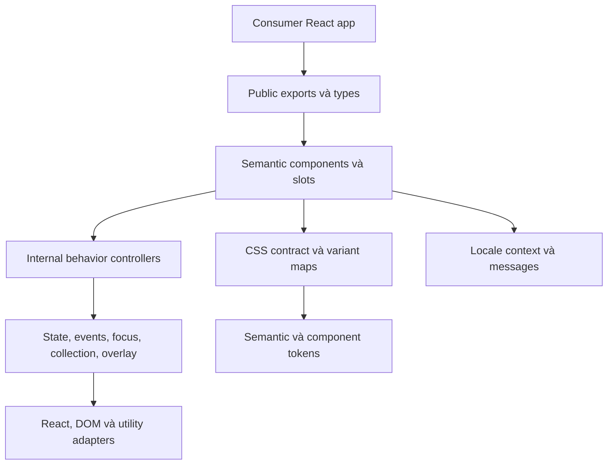
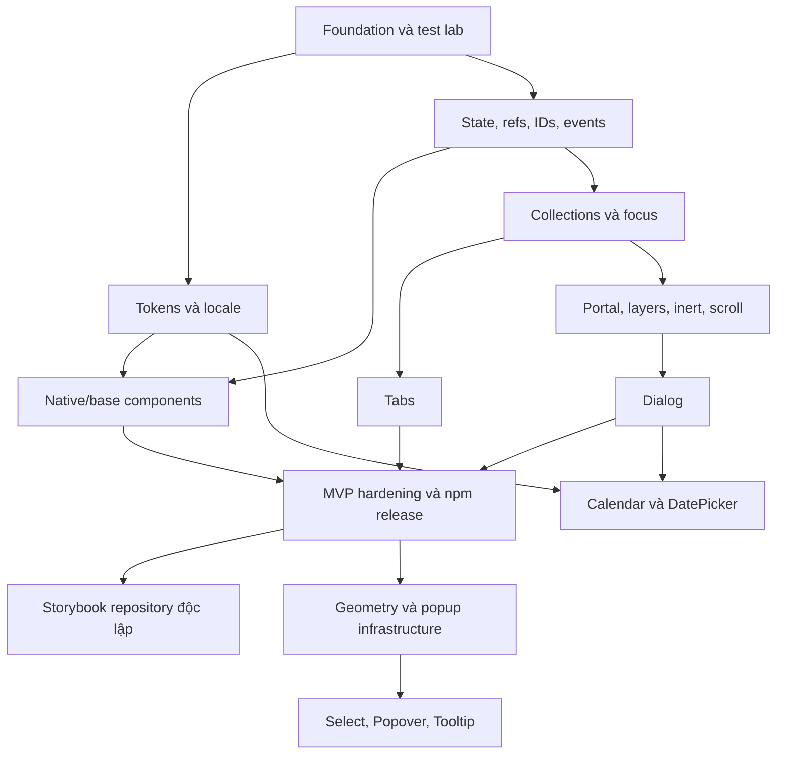

# React UI Component Library và Design System

Technical Design Document · Architecture Proposal · Trạng thái: đề xuất để phê duyệt

Ngày đối chiếu tài liệu: **30/10/2026**. `@scope/ui` và prefix `ui` là tên tạm, chưa kiểm tra quyền sở hữu npm. Toàn bộ code bên dưới là **ví dụ hợp đồng thiết kế**, không phải source đã triển khai. Không có package, repository, website hoặc release nào được tạo bởi bản kế hoạch này.

## 1. Executive Summary

Xây dựng một **hybrid library**: semantic React components có behavior tự phát triển, giao diện mặc định dựa trên CSS Variables, và một hợp đồng customization rõ ràng. Người mới import component cùng một CSS; người dùng nâng cao thay tokens, từng slot, composition hoặc chọn `unstyled` mà vẫn giữ behavior và accessibility.

Chọn **một repository, một npm package**, có subpath exports. Chưa cần monorepo, package tokens riêng, framework adapter hay public headless hooks. Logic và styling tách ở cấp source; chỉ công khai API đã có người dùng thực tế và test contract.

MVP gồm **17 components và một provider/theme family**, tập trung form, nội dung, Tabs và modal Dialog. Dùng `NativeSelect` ở MVP; `Select` tùy biến, Combobox, Tooltip, Popover và DatePicker đi sau. Không gắn nhãn “production-ready” cho component chưa vượt qua browser và assistive technology gates.

Các lựa chọn chính:

| Chủ đề | Quyết định | Đánh đổi được chấp nhận |
| --- | --- | --- |
| Sản phẩm | Hybrid, brand-neutral, customization theo contract | Cần quản lý ổn định slots/tokens như public API |
| Behavior | React + TypeScript tự viết; native HTML trước ARIA | Overlay và composite widgets cần nhiều thời gian QA |
| Runtime | MVP chỉ thêm `tabbable`; React/ReactDOM là peers | Không chạy đua “zero dependency” |
| Styling | Tailwind 4.x tại build time, CSS đã build, không Preflight toàn cục | CSS không tự tree-shake theo JS |
| Build | Vite 8 library mode + `tsc` declarations + CSS build riêng | Phải kiểm chứng directives, exports và CSS closures |
| Modules | ESM-only; explicit entry points; không UMD/CJS v1 | Dự án `require()` cũ ngoài phạm vi |
| React | `^18.3.1 || ^19.2.0`, kiểm tra hai dòng typings | Dùng `forwardRef` cho tương thích React 18 |
| Accessibility | Mục tiêu WCAG 2.2 AA + APG phù hợp | Automated testing không đủ để xác nhận toàn bộ |
| Release đầu | `0.1.0` có chất lượng vận hành; ổn định API dần trước `1.0` | Pre-1.0 vẫn phải có migration notes |
| Storybook | Repository riêng, chỉ bắt đầu sau npm release thành công | Dùng Vite lab nội bộ trước đó |

## 2. Product Vision & Differentiation

### 2.1. Ba hướng khả thi

| Hướng | Giá trị và lợi thế | Hạn chế | Độ khó / khả thi một maintainer |
| --- | --- | --- | --- |
| A. Headless interaction toolkit | Toàn quyền thiết kế; ít CSS; phù hợp design system nội bộ | Onboarding khó; người dùng phải tự hoàn thiện nhiều thứ; cạnh tranh behavior rất cao | Cao / trung bình; public hooks tạo gánh nặng tương thích |
| B. Bộ styled component cho ứng dụng nghiệp vụ | Dùng nhanh, đủ form/table/feedback; adoption dễ | Dễ thành bộ giao diện chung chung; nhiều component làm scope nở nhanh | Trung bình đến cao / tốt nếu giới hạn MVP |
| C. Hybrid với customization contract ổn định | Nhanh ở mức cơ bản; slots, state attributes và tokens phục vụ nhiều thương hiệu | Phải test cả styled/unstyled, cascade và composition | Cao nhưng kiểm soát được / **chọn** |
| D. Bộ component ưu tiên vi/en và quy trình nghiệp vụ địa phương | Nội dung, ngày tháng, ví dụ Việt rõ; giảm lỗi locale | Chỉ dịch label không đủ tạo lợi thế; không được gắn logic booking/bán hàng vào core | Trung bình / dùng như lợi thế bổ sung cho C |

**Định vị:** “Behavior đáng tin cậy, giao diện thuộc về sản phẩm của bạn.” Bản sắc nằm ở hợp đồng có thể kiểm thử: cùng behavior qua nhiều theme, từng slot có tên ổn định, tài liệu giới hạn rõ, locale vi/en đầy đủ, native form integration tốt. Không tuyên bố những khả năng này chưa từng tồn tại ở thư viện khác; khác biệt cần được xác thực bằng DX và chất lượng.

### 2.2. Sản phẩm cụ thể cần chứng minh

Ba mẫu thương hiệu trên cùng một form + Dialog + Tabs: trung tính, tương phản cao, và màu thương hiệu tùy ý. Chỉ thay CSS/tokens, không fork behavior. Hai developer thử tích hợp độc lập; mục tiêu cài và render Button trong ≤10 phút, đổi thương hiệu trong ≤30 phút theo hướng dẫn. Đây là mục tiêu usability, cần quan sát thực tế, không phải benchmark đã đạt.

Không làm MVP: copy-paste CLI, Figma plugin, JSON schema form engine, drag-and-drop, scheduling, DataGrid, CSS-in-JS runtime, hệ thống animation chung hoặc theme editor online.

## 3. Functional / Non-functional Requirements

### 3.1. Giả định và giới hạn

| Giả định | Ảnh hưởng | Nếu thay đổi |
| --- | --- | --- |
| Một frontend developer có kinh nghiệm, Codex hỗ trợ | Ưu tiên số component nhỏ, ít công cụ, release gates rõ | Có thêm maintainer mới tăng scope |
| Ứng dụng web React; không React Native | Native DOM, Pointer Events, CSS Variables | React Native là sản phẩm khác |
| Browser hiện đại | Chrome/Edge ≥111, Safari ≥16.4, Firefox ≥128 là floor dự kiến; phải test floor trước khi công bố | Cần browser cũ thì đổi ADR styling trước triển khai [S03] |
| React 18.3.1 và 19.2+ | Không dùng API chỉ có ở React 19 trong implementation chung | Bỏ React 18 là breaking change |
| ESM bundler, TS consumer ≥5.5 | Không hứa CJS hoặc TypeScript đời cũ | Thêm matrix trước mở rộng hỗ trợ |
| DatePicker đầu tiên chỉ Gregorian date-only | Không UTC/DST trong value; không âm lịch Việt Nam | DateTime/timezone cần proposal riêng |
| vi/en, LTR; chuẩn bị logical properties | `dir` có contract và test cơ bản; RTL đầy đủ chưa được chứng nhận | Locale RTL mới phải có audit riêng |
| Một bản thư viện và một phối hợp overlay trên mỗi document | Nhiều React roots chia sẻ manager theo document | Nhiều version cùng trang/microfrontend chưa hỗ trợ |

Yêu cầu chức năng: import từ npm; theme toàn app hoặc scoped; default usable và advanced composition; controlled/uncontrolled; native forms; vi/en; SSR không crash; package độc lập; documentation và examples.

Yêu cầu phi chức năng: API có type contracts; không load DOM lúc module evaluation; không bundle React; không listener khi overlay không hoạt động; không CSS reset ngoài phạm vi; mọi thay đổi public surface có changelog; không tác vụ analytics/network runtime.

## 4. Technology Stack & Decisions

### 4.1. Công nghệ và phiên bản

Tài liệu chính thức đang thể hiện React 19.3, Tailwind 4.3, TypeScript 6.0 và Vite 8. Không chọn version theo trí nhớ hoặc coi mọi trang “latest” là registry dist-tag. Phase 0 phải ghi **exact patch, engines, peers, license, thời điểm kiểm tra** vào `docs/versions.md`, tạo lockfile ở phase foundation và chạy smoke matrix. [S01–S07]

| Công cụ | Baseline đề xuất | Lý do và kiểm chứng |
| --- | --- | --- |
| Node | 24 LTS, exact patch trong `.node-version` | Dòng đã trưởng thành; Node 26 vừa vào LTS vẫn chưa cần chuyển; CI thêm Node 22.14+ cho package smoke [S07] |
| npm | 11.x tương thích, ≥11.5.1 cho OIDC | Nếu dùng OIDC dist-tag commands phải kiểm tra mức npm mới hơn trong tài liệu tại lúc release [S20] |
| React / ReactDOM | Peer `^18.3.1 || ^19.2.0`; dev pin bản 19.x stable đã kiểm chứng | Broad compatibility nhưng không hứa mọi major tương lai |
| TypeScript | 6.0.x build; declarations test với 5.5 và 6.0 | API public không dùng cú pháp type mới vượt mức consumer floor [S06] |
| Tailwind | 4.3.x + `@tailwindcss/postcss` cùng dòng | Build-time utilities và directives; consumer không phải cài Tailwind [S03–S05] |
| Vite | 8.x + `@vitejs/plugin-react` phù hợp | Lab + build library dùng chung toolchain; Vite 8 dùng Rolldown, không mô tả như Rollup cũ [S08] |
| Vitest | Dòng stable đã xác minh; ưu tiên 5.x nếu registry `latest` và peers phù hợp | Migration docs 5.x có Node ≥22.12 và Vite ≥6.4; docs không tự chứng minh dist-tag stable [S09] |
| Playwright | Stable tại foundation, pin exact và browser binaries | Dùng runner E2E cho Vite lab; không phụ thuộc experimental component runner |
| Storybook | Chọn stable lúc phase riêng, React-Vite framework | Không khóa major trước nhiều tháng; Storybook 10 đã ESM-only, cần check major đang stable khi bắt đầu [S21] |

Đây là lựa chọn kiến trúc, chưa phải lockfile tương thích đã chạy. Nếu exact versions không qua fixture, điều chỉnh **dev tool patch/minor** có ghi log; thay major/baseline/browser floor cần ADR.

### 4.2. So sánh build

| Phương án | Đánh giá | Kết luận |
| --- | --- | --- |
| Vite library mode + tsc | Lab nhanh, JS build tốt; multi-entry; phải externalize peers; declarations riêng | **Chọn**; CSS được build tách để kiểm soát phân phối [S08] |
| tsup | API đơn giản nhưng repository thông báo không còn actively maintained | Không chọn cho dự án mới [S10] |
| tsdown | Định hướng library tốt, có thể giảm cấu hình | Phương án dự phòng có ADR nếu Vite không đáp ứng directives/exports; tránh thêm cùng lúc hai bundler |
| Rollup trực tiếp | Kiểm soát chi tiết | Nhiều cấu hình hơn; chỉ cân nhắc khi có failure tái hiện được của phương án chính |
| tsc-only | Rất ít tool | Không giải quyết đầy đủ build CSS, bundle analysis và browser lab |

### 4.3. Dependency budget và quyết định tự xây

Các số KiB dưới đây là **budget gzip incremental dự kiến**, không phải số đo package trên npm. Đo code thực tế sau production tree-shaking, gồm transitives, không dùng unpacked size thay bundle size.

| Dependency | Loại / thời điểm | Vì sao dùng; tự viết và rủi ro | Bundle / lựa chọn nhẹ hơn |
| --- | --- | --- | --- |
| `react`, `react-dom` | Peer + dev | Nền tảng bắt buộc; consumer sở hữu instance | External; không tính vào incremental UI budget |
| `@types/react`, `@types/react-dom` | Dev | Type ecosystem; không tự tái tạo DOM/JSX types | 0 runtime; consumer TS có typings riêng, matrix 18/19 |
| `tabbable` | Runtime, MVP Dialog | Chỉ xác định focusable/tabbable; tự viết selector đơn giản dễ sai radio groups, hidden/inert, fieldset | Budget ≤4 KiB; native dialog là phương án khác nhưng không bỏ qua focus audit [S11] |
| `@floating-ui/dom` | Runtime, chỉ phase floating | Geometry/collision/scroll ancestors; tự viết dễ sai transform, zoom, visual viewport | Budget ≤9 KiB incremental; không dùng React behavior hooks của thư viện này [S12] |
| `@internationalized/date` | Runtime, chỉ phase date | Calendar arithmetic và date representation; không dùng React Aria hooks/components | Budget ≤6 KiB Gregorian path; tài liệu có số Brotli riêng, không đồng nhất với gzip [S13] |
| TypeScript | Dev/build | Typecheck/declaration compiler không nên tự xây | 0 runtime; không thêm dts plugin trước khi tsc thiếu khả năng |
| Vite + React plugin | Dev/build/lab | Bundling/HMR; tự xây không mang giá trị sản phẩm | 0 runtime |
| Tailwind + PostCSS adapter + PostCSS | Dev/build | Xử lý directives, CSS AST; tự viết compiler rủi ro | 0 JS runtime; CSS có chi phí cần đo |
| Vitest + coverage-v8 + jsdom | Dev/test | Unit logic, jsdom DOM cơ bản; không dùng jsdom chứng minh focus | 0 runtime; chưa thêm second unit runner |
| Testing Library React + user-event + jest-dom | Dev/test | Assert theo role/tương tác người dùng; helpers tự viết dễ lệch browser | 0 runtime |
| Playwright + `@axe-core/playwright` | Dev/test | Browser thật, accessibility rules, screenshots | 0 runtime; axe không thay kiểm tra thủ công [S14] |
| ESLint + TS/React Hooks/jsx-a11y plugins; Prettier | Dev/quality | Bắt lỗi hooks, types, semantics và formatting | 0 runtime; không đồng thời thêm Biome để làm cùng việc |
| Changesets CLI | Dev/release | Version/changelog được review theo thay đổi | 0 runtime; manual version dễ bỏ sót ảnh hưởng API [S19] |
| publint + `@arethetypeswrong/cli` | Dev/package QA | Exports/types/module resolution; tự viết toàn bộ không hợp lý | 0 runtime; giữ smoke fixtures bổ sung |
| Storybook React-Vite + docs/a11y addons | Dev, repository thứ hai | Playground/documentation; chỉ thêm addons được dùng | Không vào bundle library |

Không cài mặc định: Radix, React Aria components/hooks, MUI, AntD, Chakra, headless UI engine, Zustand, XState, lodash, date-fns/Moment, icon pack, animation engine, CVA, clsx, tailwind-merge. Tự viết `cx` chỉ nối string/false/undefined; variant map có union types. Không tự viết một “tailwind-merge thu nhỏ”: đó là bài toán khác và không cần với CSS contract đã chọn.

Runtime dependency mới cần record: vấn đề tái hiện, alternatives, license/security, transitive graph, số đo min+gzip, entry points bị ảnh hưởng, maintainer status và replacement plan. Dependency tương lai chỉ được thêm khi phase tương ứng bắt đầu.

## 5. Architecture Design

### 5.1. Layers và luồng phụ thuộc



Mũi tên là dependency. `core` không import components, tokens hoặc root barrel. CSS không import JS. Locale helpers thuần không phụ thuộc DOM. Behavior không quyết định màu, spacing hoặc theme. Styled/unstyled dùng cùng implementation semantics, không tồn tại hai state machines.

| Layer | Trách nhiệm | Không được làm |
| --- | --- | --- |
| Core | Controlled state, event composition, refs, IDs, collections, focus, ownerDocument, portal lifecycle | Chứa kiến thức Button variant hoặc nhãn business |
| Behavior | Chuyển events thành trạng thái và prop contracts riêng mỗi family | Phụ thuộc CSS selector nội bộ để tìm state |
| Component | Semantic DOM, slots, context đúng phạm vi, public props | Fetch dữ liệu, validation nghiệp vụ, router coupling |
| Styling | Tokens, state selectors, layout mặc định, variants | Điều khiển state bằng DOM mutation hoặc hide element đang focus |
| Public API | Explicit re-exports, types, CSS entry map, API snapshot | Export mọi utility nội bộ cho tiện |

### 5.2. Core primitives

| Primitive | Hợp đồng cần có |
| --- | --- |
| `useControllableState` | Controlled khi value khác undefined; initial mode cố định; default chỉ dùng lần mount; callback đúng một lần mỗi thay đổi thực; functional update không stale; cảnh báo mode switch |
| `composeEventHandlers` | User handler trước internal action; defaultPrevented chặn hành động có thể hủy; cleanup và ARIA invariants không bị hủy |
| `composeRefs` | Object/callback refs, mount/unmount, React 19 callback cleanup tương thích; không đọc `element.ref` |
| Stable IDs | `useId`; explicit ID ưu tiên; không random/counter global; nhiều SSR roots cần `identifierPrefix` |
| Collection + roving focus | Registry theo DOM order, stable keys, disabled policy riêng widget, dynamic removal, orientation/dir |
| Portal | Không truy cập document lúc import/render server; tạo host trong effect; cleanup; default open portal chỉ xuất hiện sau client mount |
| Overlay manager | Document-scoped lazy manager; stack và parent ownership; một bộ listeners cho document đang có overlay; refcount subscription; clear khi không còn layer |
| Focus scope | Tabbable adapter, initial focus, Tab loop modal, restoration; container fallback; xử lý element bị xóa |
| Inert/scroll lock | Snapshot giá trị gốc; refcount; phục hồi chính xác; tính scrollbar, iOS scroll, nested modals |
| Form bridge | Native control trước; reset event và form ownership; custom controls submit hidden value có contract rõ |

Không đưa reducer framework/state machine library vào runtime. Với overlay/select/date, viết transition table và reducer thuần nếu nhiều trạng thái. Async callbacks của người dùng không được tự suy ra “pending” hoặc tự đóng overlay khi Promise hoàn thành.

### 5.3. Overlay là subsystem cần đặc tả riêng

MVP chỉ public **modal Dialog**, không giả một boolean `modal=false` chưa được kiểm thử. Dialog custom DOM (`role=dialog`) được chọn để kiểm soát portals, scoped theme và composition thống nhất với overlay tương lai. Native `<dialog>` là alternative đáng cân nhắc nếu focus/inert subsystem vượt quá chi phí dự kiến; thay đổi này cần ADR và cùng acceptance suite, không chọn vì nghĩ native tự giải quyết mọi accessibility.

Mỗi open layer có `id`, parent layer, content element, trigger element, branches sở hữu và restore target. ESC chỉ gửi đến lớp trên cùng. Pointerdown bắt đầu trong content rồi pointerup bên ngoài không bị coi là outside click. Khi child popup ở portal khác, interaction thuộc nhánh child không dismiss parent.

Modal làm inert các sibling branches ngoài active modal và owned descendants; không inert ancestor chứa modal. Nếu host ở trong app root, đi theo đường ancestor để xác định sibling cần inert. Modal lồng phải làm parent modal không tương tác; khi đóng child khôi phục parent trước khi restore focus. Không `aria-hidden` một ancestor đang chứa focused element. Tất cả mutations được ghi sổ để restore giá trị có từ trước, không xóa thuộc tính của app.

Manager dùng `WeakMap<Document, Manager>` tạo lazy; chỉ lưu coordination của DOM đang mount, không lưu theme/locale/user data. Đây là ngoại lệ có lý do cho module state, không store ứng dụng. Nhiều React roots dùng cùng package phối hợp; nhiều bản package trên cùng document ngoài phạm vi v1.

### 5.4. Anti-patterns

Không tự build generic polymorphic engine cho tất cả tags; không clone children tùy ý bằng `asChild`; không form library ẩn; không Context duy nhất phát mọi trạng thái toàn thư viện; không barrel import nội bộ; không deep imports `/dist/...`; không lấy state từ CSS class; không dùng `setTimeout` để “sửa” focus thiếu mô hình; không toast singleton global; không dùng memo khắp nơi khi chưa profile.

## 6. Package / Folder Structure

Một root package; `lab` và `tests/fixtures` là tooling private trong repository, **không** đồng nghĩa monorepo nhiều release units.

```text
ui-library/
  src/
    index.ts
    components/
      button/{button.tsx,button.types.ts,button.css,index.ts,button.test.tsx}
      dialog/{dialog.tsx,dialog-context.ts,dialog-state.ts,dialog.css,index.ts}
      ...
    core/{state,events,refs,ids,collection,focus,overlay,portal,form}/
    adapters/{tabbable.ts,floating.ts,date.ts}
    providers/{ui-provider.tsx,theme-scope.tsx,locale-context.tsx}
    locales/{types.ts,en.ts,vi.ts,index.ts}
    styles/{layers.css,tokens.css,structural.css,styles.css}
    tokens/{tokens.ts,schema.ts}
  lab/{index.html,src/main.tsx,src/cases/}
  tests/{browser,accessibility,types,package,fixtures,visual}/
  scripts/{build-css.mjs,validate-package.mjs,measure-bundles.mjs}
  docs/{adr,components,a11y,reports,versions.md,public-api.md}
  .github/workflows/{ci.yml,release.yml}
  .changeset/
  vite.config.ts
  vite.lab.config.ts
  tsconfig.json
  tsconfig.build.json
  package.json
  package-lock.json
  ARCHITECTURE.md
  ROADMAP.md
  COMPONENT_GUIDELINES.md
  TESTING_STRATEGY.md
  CONTRIBUTING.md
  AGENTS.md
```

Danh sách là layout dự kiến; không tạo file trống hàng loạt. Adapter floating/date chỉ xuất hiện ở phase tương ứng. Component nhỏ không bắt buộc tách types/hook nếu làm giảm readability. Mỗi folder có owner logical là family, không “utils.ts” hàng nghìn dòng.

Exports dự kiến: root; `/button`, `/input`, `/dialog`, `/tabs` và từng family stable; `/providers`; `/locales/en`, `/locales/vi`; `/styles.css`; `/tokens.css`; `/button.css`, `/dialog.css`… Source TSX và Tailwind source không phải consumer entry v1. Mọi public symbol phải xuất hiện trong API inventory và type test. Không export `/core` trước có nhu cầu được chứng minh.

Tách package khi có ít nhất một lý do đo được: cycle release khác nhau, runtime dependency bắt buộc quá lớn, consumer không React cần tokens, hoặc maintainer ownership độc lập. Subpath tree-shaking giải quyết download JS; nhiều npm packages không tự cải thiện runtime.

## 7. Component API Standards

### 7.1. Quy chuẩn chung

| Chủ đề | Quy chuẩn |
| --- | --- |
| Tên props | Native giữ nguyên: `disabled`, `required`, `name`, `onChange`; custom value dùng `value/defaultValue/onValueChange`; overlay dùng `open/defaultOpen/onOpenChange` |
| Variants | `variant` mô tả visual treatment, `tone` mô tả ngữ nghĩa; không cùng lúc `primary secondary danger outlined` |
| Size | `size="sm\|md\|lg"` khi không xung đột HTML; Input/NativeSelect dùng `controlSize`, giữ native `size` |
| Native event | Input giữ `ChangeEvent`; custom value callback `(value, details)`; không ép callback chung cho mọi widget |
| Empty | Text `""`; Select/DatePicker `null`; `undefined` dành cho uncontrolled |
| Ref | DOM node điều khiển chính; compound Root không có DOM không nhận ref; mỗi part nhận ref đúng node |
| DOM escape | `className`, `style`, `data-*`, `aria-*`; internal IDs/role/state association là protected props ở custom parts |
| Slots | `slotProps` typed theo từng slot; expose class/style/attributes thích hợp; không cho thay semantic role, tabIndex, control state tùy ý |
| State | `data-ui-component`, `data-ui-slot`, `data-state`, `data-disabled`, `data-invalid`; có bảng contract từng family |
| Unstyled | Gỡ decorative classes; giữ structural/a11y behavior, state attributes và semantic DOM; không đồng nghĩa không cần CSS |
| Validation | `invalid` + message associations; không parse business schema, không validate email/phone giúp app |
| Defaults | Có documented defaults; không đọc navigator/media query để đổi SSR markup lần render đầu |

`slotProps.root` bị loại; root dùng top-level props. Mỗi slot chỉ có **một** nơi cấu hình; nếu đã dùng compound part thì đặt props lên part, không thêm slotProps từ Root cho cùng part. Slot className có thể là string hoặc `(state) => string`; style là object typed; class order trong HTML không phải precedence CSS.

Người dùng được phép thay `aria-label`, `aria-labelledby` theo documented name strategy; không override `aria-expanded`, `aria-controls`, `role`, `aria-selected` tùy ý làm sai model. Development warnings cho missing accessible name; không suy từ placeholder.

### 7.2. Patterns

| Pattern | Chọn ở đâu | Giới hạn |
| --- | --- | --- |
| Composition | Mặc định toàn hệ thống | React children là nội dung, không inspect tùy tiện để lấy business data |
| Compound | Dialog, Tabs, Accordion; Select advanced sau MVP | Context chỉ trong family; lỗi rõ khi part ngoài Root |
| Controlled/uncontrolled | Mọi stateful family phù hợp | Mode không đổi trong vòng đời |
| Hooks | Core nội bộ; public chỉ sau audit riêng | Không public prop getters sớm, tránh consumer bỏ sót ARIA |
| Context | Compound + locale/config | Tách config/state/actions nếu profiling cho thấy cần |
| Render props | Trigger adapter hoặc item rendering có nhu cầu | Consumer phải spread **toàn bộ** props và ref vào semantic element |
| Polymorphic | Chưa có generic `as`/`asChild` v1 | `Button` chỉ button; link dùng Link hoặc styled anchor riêng |
| Slot customization | Component đơn có wrapper/icon, rendering convenience | Typed allow-list; không `Record<string, any>` |

### 7.3. Button

Các ví dụ API dưới đây là usage fragments: state/handlers/icon riêng của app được giả định đã khai báo. `UIStyle` là public type dự kiến, có template-literal keys cho CSS Variables `--ui-*`; không yêu cầu consumer cast sang `any`. Khi triển khai, docs fixtures phải thêm imports và state wrapper đầy đủ rồi compile against packed package.

```tsx
import { Button } from "@scope/ui";
import "@scope/ui/styles.css";

<Button variant="primary" size="lg" type="submit">Lưu</Button>

<Button
  variant="outline"
  tone="danger"
  loading={saving}
  loadingLabel="Đang xóa"
  startIcon={<TrashIcon aria-hidden="true" />}
  className="delete-action"
  slotProps={{ label: { className: "delete-label" } }}
  style={{ "--ui-button-radius": "999px" } as UIStyle}
  onClick={handleDelete}
>
  Xóa bản nháp
</Button>
```

`variant`: primary/secondary/outline/ghost; `tone`: brand/neutral/danger; sizes 32/40/48px. Không đồng thời có `fullWidth` và `block`: chọn className/layout của app. Default `type=button`; icon-only phải có accessible name; spinner decorative. `disabled` native loại khỏi tab order. `loading` dùng `aria-disabled=true` + `aria-busy=true`, giữ focus và chặn click/keyboard activation; nếu app truyền native disabled thì disabled thắng. Không tự submit, không auto-await onClick. Không controlled state riêng: loading do app sở hữu. Label loading phải thông báo hữu ích mà không gây live region lặp ở mọi render.

### 7.4. Input và Field

```tsx
<Field id="email-field" invalid={Boolean(error)}>
  <FieldLabel htmlFor="email">Email</FieldLabel>
  <Input id="email" name="email" type="email"
    defaultValue="" autoComplete="email"
    aria-describedby={error ? "email-help email-error" : "email-help"}
    invalid={Boolean(error)} />
  <FieldDescription id="email-help">Dùng email bạn thường kiểm tra.</FieldDescription>
  {error && <FieldError id="email-error">{error}</FieldError>}
</Field>

<Input id="search" aria-label="Tìm sản phẩm"
  value={query} onChange={(event) => setQuery(event.currentTarget.value)}
  controlSize="lg" size={24} className="brand-input"
  style={{ "--ui-control-radius": "0.75rem" } as UIStyle} />
```

`Input` là input native không thêm wrapper. `Field*` là các export phẳng cùng family; ví dụ explicit IDs là hợp đồng ưu tiên, không clone child tự thêm props. Field chỉ bố cục/nhãn/mô tả; `invalid` trên Field phục vụ styling, control phải nhận invalid riêng để ARIA đúng. Nếu cần prefix/suffix, `InputGroup` là family tương lai, không nhét icon props vào Input v1. Native `readOnly`, `required`, selection, IME và form reset được giữ. Không format lại giá trị mỗi keystroke; không debounce nội bộ. Error có `aria-invalid`; chỉ liên kết ID đang tồn tại, không ép mọi lỗi thành assertive alert.

### 7.5. Select

**MVP là NativeSelect**, sự lựa chọn này không được đổi ngầm thành custom Select trong minor release:

```tsx
<label htmlFor="branch">Chi nhánh</label>
<NativeSelect id="branch" name="branch" defaultValue="hue" controlSize="md">
  <option value="hue">Huế</option>
  <option value="hcm">TP. Hồ Chí Minh</option>
</NativeSelect>
```

**Custom Select sau MVP:** select-only combobox, single selection, không search. Data API đủ dễ dùng; advanced rendering dùng `renderOption` và slots nhưng không thay DOM role của option.

```tsx
const options = [
  { value: "hue", label: "Huế", textValue: "Huế" },
  { value: "hcm", label: "TP. Hồ Chí Minh", textValue: "TP. Hồ Chí Minh" },
];

<Select label="Chi nhánh" name="branch" options={options} defaultValue="hue" />

<Select label="Chi nhánh" options={options}
  value={branch} onValueChange={(next, details) => setBranch(next)}
  open={selectOpen} onOpenChange={setSelectOpen}
  renderOption={(option, state) => <span>{state.selected ? "✓ " : ""}{option.label}</span>}
  slotProps={{ trigger: { className: "branch-trigger" }, listbox: { className: "branch-list" } }}
/>
```

Value là `string | null`, option values unique/nonempty; không generic object identity để tránh equality/serialization khó hiểu. `textValue` bắt buộc khi label không phải text. Internal state tách `open`, `selectedValue`, `activeValue`, `typeaheadBuffer`; hover/arrows chỉ đổi active, Enter/Space/click commit; Escape cancel; Tab đóng và giữ selected cũ nếu chưa commit. Initial active = selected hợp lệ hoặc option enabled đầu tiên. Search là `Combobox`, multi selection là proposal riêng.

DOM focus ở trigger, active option qua `aria-activedescendant`; `role=combobox`, `aria-expanded`, `aria-controls`, popup listbox và option selected. Không interactive element bên trong option. Hidden input chỉ phục vụ submit value; không được quảng cáo native required-validation/autofill tương đương select. Custom Select có explicit validation contract; reset trả default trong uncontrolled hoặc gọi change reason `form-reset` ở controlled. Cần adapters form-lib bằng props/ref, không peer dependency form-lib.

### 7.6. Dialog

```tsx
<DialogRoot defaultOpen={false}>
  <DialogTrigger>Mở xác nhận</DialogTrigger>
  <DialogPortal>
    <DialogBackdrop />
    <DialogContent>
      <DialogTitle>Xác nhận thay đổi</DialogTitle>
      <DialogDescription>Kiểm tra thông tin trước khi lưu.</DialogDescription>
      <DialogClose>Đóng</DialogClose>
    </DialogContent>
  </DialogPortal>
</DialogRoot>

<DialogRoot open={open} onOpenChange={(next, details) => setOpen(next)}>
  <DialogTrigger render={(props) => <Button {...props}>Chỉnh sửa</Button>} />
  <DialogPortal container={overlayHost}>
    <DialogBackdrop className="brand-backdrop" />
    <DialogContent initialFocusRef={titleRef} restoreFocusRef={fallbackRef}
      dismissPolicy="escape" className="brand-dialog">
      <DialogTitle ref={titleRef} tabIndex={-1}>Cập nhật hồ sơ</DialogTitle>
      <ProfileForm />
      <DialogClose aria-label="Đóng hộp thoại">×</DialogClose>
    </DialogContent>
  </DialogPortal>
</DialogRoot>
```

Exports phẳng là canonical để tree-shaking dễ đo; `Dialog.*` namespace object chưa phát hành v1. Trigger/Close mặc định là button, `type=button`; render adapter nhận đầy đủ event/ref/ARIA props, child phải forward ref. `dismissPolicy="escape-and-outside" | "escape"` mặc định escape-and-outside; không cung cấp “không có đường thoát”. App có thể dùng controlled state để giữ open khi có lý do, phải có close/cancel rõ ràng; thư viện không tự chặn Escape khi form dirty.

Content chỉ có `role=dialog`, `aria-modal=true`, accessible title bắt buộc. Mô tả dài không tự gắn toàn bộ vào aria-describedby: người dùng chọn explicit description. Focus ưu tiên ref, rồi control phù hợp, cuối cùng content `tabIndex=-1`; đóng restore trigger còn tồn tại, fallbackRef, rồi vị trí hợp lý do app cung cấp. Không hứa SSR render nội dung portaled đang open: server và first client render cùng rỗng, sau mount mới hiển thị, phải document trade-off này.

### 7.7. Tabs

```tsx
<TabsRoot defaultValue="overview">
  <TabsList aria-label="Thông tin chi nhánh">
    <TabsTrigger value="overview">Tổng quan</TabsTrigger>
    <TabsTrigger value="hours">Giờ mở cửa</TabsTrigger>
  </TabsList>
  <TabsContent value="overview">Thông tin</TabsContent>
  <TabsContent value="hours">Lịch hoạt động</TabsContent>
</TabsRoot>

<TabsRoot value={tab} onValueChange={setTab}
  activationMode="manual" orientation="vertical" unstyled>
  <TabsList aria-label="Cài đặt" className="brand-tabs">
    <TabsTrigger value="profile">Hồ sơ</TabsTrigger>
    <TabsTrigger value="security">Bảo mật</TabsTrigger>
  </TabsList>
  <TabsContent value="profile">...</TabsContent>
  <TabsContent value="security">...</TabsContent>
</TabsRoot>
```

Default activation manual để không tự load nội dung nặng khi di chuyển focus. Automatic chỉ dùng khi panel có sẵn và phản hồi nhanh. Roving tabIndex, Home/End, arrows theo orientation/dir, disabled được bỏ qua, Enter/Space activate manual. Panels mặc định keep mounted + `hidden` khi inactive để không mất form state; `mountStrategy="active-only"` opt-in cần giải thích mất state. Selected value bị remove: uncontrolled chuyển enabled đầu; controlled gọi yêu cầu đổi với reason `item-removed`, không tự sửa prop của app. Dynamic mutations phải giữ tab stop hợp lệ dù app chậm phản hồi.

### 7.8. DatePicker sau MVP

```tsx
type CalendarDateValue = Readonly<{ year: number; month: number; day: number }>;

<DatePicker label="Ngày hẹn" name="appointmentDate" locale="vi"
  defaultValue={{ year: 2027, month: 1, day: 15 }}
  referenceDate={{ year: 2027, month: 1, day: 1 }} />

<DatePicker label="Ngày hẹn" locale="en" value={date}
  onValueChange={(next, details) => setDate(next)}
  minDate={{ year: 2027, month: 1, day: 1 }}
  maxDate={{ year: 2027, month: 12, day: 31 }}
  referenceDate={serverReferenceDate}
  isDateUnavailable={(day) => blockedDates.has(toISODate(day))}
  slotProps={{ input: { className: "brand-date" }, calendar: { className: "brand-calendar" } }}
/>
```

Public value là immutable civil date object hoặc null, không `Date` timestamp, không lộ type dependency. Gregorian năm 1–9999, ngày hợp lệ; hidden form value `YYYY-MM-DD`. Adapter chuyển sang `@internationalized/date` bên trong. Locale `vi` format dd/MM/yyyy, `en` default en-US MM/dd/yyyy; nhập theo format hiển thị, parse strict, không `new Date(userText)`. Không fuzzy parse. Draft text riêng với committed value; chỉ commit khi date hợp lệ qua Enter/blur hoặc chọn ngày; invalid giữ draft và hiện lỗi, không đổi selected value.

Popup đầu tiên là modal Dialog chứa Calendar để một focus model ổn định trên desktop/mobile. Calendar grid roving focus, arrows ±1/7 ngày, Home/End đầu/cuối tuần, PageUp/Down tháng, Shift+PageUp/Down năm, Enter/Space chọn. Disabled/unavailable dates có thể focus để đọc lý do nhưng không chọn; announce tháng khi đổi, không live announce cả grid mỗi render. `referenceDate` bắt buộc khi value/defaultValue rỗng để SSR determinism; consumer có thể lấy ngày hiện tại bằng timezone họ chọn, truyền cùng dữ liệu cho server/client. Không âm lịch, time, date range hoặc timezone picker ở release đầu của family này.

Trade-off: object value dài hơn string; parser locale cần test kỹ; modal tốn thêm một thao tác nhưng dễ làm accessible hơn menu lịch tự do. `Input type="date"` là lựa chọn nhẹ cho app không cần calendar tùy biến.

## 8. Design Token & Theming Architecture

### 8.1. Ba cấp tokens

| Cấp | Ví dụ | Quy tắc |
| --- | --- | --- |
| Global/reference | `--ui-palette-brand-600`, `--ui-space-2`, `--ui-font-size-3`, `--ui-radius-2` | Thang giá trị; không dùng màu reference trực tiếp trong component |
| Semantic | `--ui-color-surface`, `--ui-color-text`, `--ui-color-border`, `--ui-color-action`, `--ui-color-danger`, `--ui-focus-color` | Ý nghĩa xuyên theme; light/dark đổi mapping |
| Component | `--ui-button-bg`, `--ui-button-radius`, `--ui-dialog-max-inline-size` | Escape hatch có giới hạn; dùng fallback về semantic |

Source of truth là typed token object và schema trong source, generator build ra CSS + inventory. Không thêm Style Dictionary cho một package nhỏ. Tokens có đơn vị; màu sRGB baseline, OKLCH chỉ khi fallback/chứng minh browser đủ. Thang spacing 0/2/4/8/12/16/24/32/48/64px, typography 12/14/16/18/24/32px với line height 1.4–1.6, radius 0/4/8/12/full, shadows 3 cấp, motion 120/180/240ms. Focus ring 2px offset 2px là lựa chọn thiết kế, không diễn giải như toàn bộ yêu cầu AA.

Component CSS **không gán giá trị mặc định cho public component variable ngay trên element**, vì như vậy có thể che override kế thừa. Ví dụ dùng `background: var(--ui-button-bg, var(--_ui-button-default-bg))`; variant chỉ gán private `--_ui-*` fallback. Public tokens và slots phải có versioning.

### 8.2. Tailwind tại build time

Tailwind dùng cho các static utility declarations trong CSS scoped, không emit class ngẫu nhiên từ props runtime. Cách tác giả viết dự kiến:

```css
/* Source only; compiler xử lý @reference và @apply. */
@reference "tailwindcss";
@layer ui-components {
  :where(.ui-Button) {
    @apply inline-flex items-center justify-center;
    box-sizing: border-box;
    font: inherit;
    gap: var(--ui-space-2);
    background: var(--ui-button-bg, var(--_ui-button-default-bg));
    border-radius: var(--ui-button-radius, var(--ui-radius-2));
  }
}
```

Build CSS dùng PostCSS/Tailwind adapter, `@reference` không mang toàn bộ stylesheet vào output. Bản prototype phải kiểm tra output không có Preflight, utility toàn cục hoặc biến `--tw-*` chưa khai báo. Với utility cần internal property initialization như transform/ring/shadow, v1 dùng CSS Variables của thư viện và CSS trực tiếp thay vì phụ thuộc reset/property sheet ẩn. Đây là ranh giới intentional, không cố viết tất cả CSS bằng Tailwind. [S05]

Consumer mặc định:

```tsx
import { Button } from "@scope/ui";
import "@scope/ui/styles.css";
```

Không Tailwind peer dependency, không yêu cầu content scanning `node_modules`. Tailwind không scan dependency mặc định, nên source-only distribution sẽ gây thêm cấu hình và lỗi thiếu styles; không chọn mô hình đó. [S04]

### 8.3. Cascade và overrides

`layers.css` công bố `@layer theme, base, ui-tokens, ui-components, components, utilities;`. Với app Tailwind v4, prelude này phải xuất hiện **trước lần khai báo layer đầu tiên**, sau đó import Tailwind và library theo hướng dẫn; load library muộn không thể sửa lại thứ tự layer đã đăng ký. Có fixture kiểm tra cả import order đúng và sai để tài liệu chỉ rõ.

Plain CSS app: selectors thư viện specificity thấp nhờ `:where`; unlayered app CSS thắng layered library CSS với normal declarations. Tailwind v3 utilities thường xuất ra unlayered sau build và được test riêng. Không tuyên bố “className cuối thắng”, không `!important` đại trà. State-specific override của app nên dùng `data-state` hoặc custom token; style inline thắng normal declarations nhưng vẫn có thể thua external `!important`.

Không reset `button`, `input`, `*`, `body` toàn cục. Chỉ scoped structural reset; semantic tokens namespaced. Các rule an toàn như visually-hidden, hidden panel và hit target phải được kiểm chứng nếu `unstyled`; user có thể tự làm accessibility hỏng bằng CSS, thư viện phải document trách nhiệm.

### 8.4. Theme và portal

Default light dùng root tokens; dark qua `data-ui-theme="dark"`; custom theme bằng CSS class/attribute đặt semantic variables. `UIProvider` quản lý locale, dir và explicit portal host config, không inject inline token styles. `ThemeScope` là DOM wrapper với theme/density; theme ở DOM, không state màu trong React context.

CSS Variables kế thừa theo DOM, **không theo React portal context**. ThemeScope tạo overlay host cùng scope sau mount. Với root scope có overflow/transform, app đặt host ở sibling ngoài vùng clipping, trong cùng theme root; `portalContainer` override là API rõ ràng. Khi override ra ngoài scope, consumer phải đặt cùng theme class/attribute/tokens lên host. Không tự sao chép `getComputedStyle` mỗi frame; không giả copy `data-theme` sẽ mang theo mọi CSS override của ancestor. Có example hai ThemeScopes mở Dialog đồng thời.

System dark mode dùng CSS media query dưới `data-ui-theme="system"` với SSR attribute cố định. Tùy chọn nhớ theme ở localStorage thuộc app; nếu cần tránh flash, app resolve cookie/initial attribute trước hydrate. Component không đọc localStorage trong render.

### 8.5. CSS distribution

Phát hành aggregate `styles.css` và opt-in per-component CSS **đã chứa transitive structural/token dependencies cần thiết**. `button.css` có layers/tokens/button; `dialog.css` có structural portal/dialog và các internal styles cần thiết. Không chứa styles của component người dùng tự composition như Button trong Dialog. Manifest closure được build/test; khi import nhiều per-component CSS có thể lặp tokens, ghi budget và đo, không hứa dedupe xuyên mọi bundler.

JS không auto-import CSS để SSR Node import và tree-shaking minh bạch. `sideEffects: ["**/*.css"]`; JS side effects phải nằm trong effect/event lifecycle. CSS aggregate không được coi là tree-shaken chỉ vì JS tree-shaken. Source styles không public ở v1; tương lai source adapter Tailwind theo version riêng nếu có nhu cầu.

## 9. Localization Architecture

Locale mặc định `en`, mapping format `en-US`; `vi` mapping `vi-VN`. Chọn en cho package open-source quốc tế, nhưng vi và en có cùng release gate. Component-level locale override > provider gần nhất > default en. Mỗi message key fallback từ component overrides sang active locale rồi en; không chỉ merge object nông làm mất nhánh nested.

```tsx
import { UIProvider } from "@scope/ui/providers";
import { vi } from "@scope/ui/locales/vi";

<UIProvider locale={vi}>
  <EmptyState />
  <Pagination page={page} onPageChange={setPage} totalPages={12} />
</UIProvider>
```

Các ví dụ sau MVP như Pagination không nằm trong MVP dù API được định hướng sớm. Locale schema typed, có functions cho plural/count, ví dụ `pagination.pageLabel(page,total)`, `calendar.chooseDate(dateText)`, `select.results(count)`. `Intl.DateTimeFormat`, `Intl.NumberFormat`, `Intl.PluralRules` cho formatting; cache hữu hạn theo locale/options, không store vô hạn. Không dependency i18n runtime.

`en` fallback nhỏ được bundle mặc định; `vi` explicit subpath để tree-shake. Không runtime dynamic import tự động, không suspense chỉ vì đổi ngôn ngữ. `defineLocale` typed helper cho locale thứ ba; từng locale khai báo first day of week, locale tag, direction và messages. vi: Monday, en-US: Sunday; `weekStartsOn` override explicit ở Calendar. User-supplied labels không bị tự dịch.

Hydration: locale/format options giống server/client; không tự lấy navigator.language ở render. Default messages không dùng ngày hôm nay, thời gian hiện tại hoặc random. Date-only format qua adapter và timezone cố định, không đổi ngày do server timezone.

Tài liệu: Markdown/MDX vi/en riêng; API names và examples imports giống nhau. Dịch docs có review/fallback status riêng, không dùng locale runtime messages làm hệ thống dịch MDX. Release note tiếng Anh và bản Việt ưu tiên các breaking changes.

## 10. Accessibility Strategy

Mục tiêu WCAG 2.2 AA cho supplied components và example compositions; không chứng nhận toàn bộ app consumer. WCAG là chuẩn yêu cầu; APG là guidance tương tác, không specification bảo đảm production code. DatePicker APG có cảnh báo cần kiểm thử assistive technology; Tooltip pattern còn work in progress. [S15–S18]

| Family | Keyboard / focus | Semantics / announcements | Edge cases bắt buộc |
| --- | --- | --- | --- |
| Button | Native Enter/Space | button + name; loading busy | disabled khác loading; không double click callback |
| Input/Textarea | Native editing, selection, IME | label, describedby, invalid, required | Autofill, reset, readOnly, lỗi không chỉ màu |
| Checkbox/Switch | Native checkbox Space | checked/mixed; switch role nếu đúng boolean | Mixed chỉ Checkbox, `.indeterminate` sync; reset |
| RadioGroup | Native radio behavior theo group | fieldset/legend hoặc labelled group | Disabled, same-name form ownership |
| Tabs | Roving arrows, Home/End; manual Enter/Space | tablist/tab/tabpanel IDs | Dynamic remove, vertical, RTL basis, hidden panel không focus |
| Accordion | Button Enter/Space | expanded/controls; headings | Multiple panels, heading level do app chọn |
| Dialog | Initial focus, modal Tab loop, Escape, restore | dialog, modal, title | Nested layers, trigger unmount, iOS scroll/inert |
| Select | Focus trigger, active descendant, typeahead | combobox/listbox/option | IME không bị đánh cắp; empty/disabled/options change |
| Combobox | Input editing không bị override; arrows active | autocomplete/listbox, expanded | Composition events, async stale response thuộc app |
| Tooltip | Focus ở trigger, Escape dismiss | tooltip + describedby | Không focusable content; hoverable/dismissible/persistent |
| DatePicker | Modal + grid navigation | Ngày đọc đủ, heading tháng live polite | Leap year, unavailable, parse error, mobile screen reader |
| Table | Native table semantics | caption, scope headers, sort aria-sort ở bản sau | Không gắn role grid cho bảng đọc thông thường |
| Alert/Spinner | Không tự lấy focus | alert chỉ urgent dynamic; status cho loading cần nghe | Static content không announce lặp; reduced motion |

Màu text thông thường ≥4.5:1; large text ≥3:1; UI boundary/state indicator cần tương phản phù hợp ≥3:1. Focus nhìn rõ và không bị che; không khẳng định riêng tiêu chí Focus Appearance (AAA) là AA. Mục tiêu target tối thiểu 24×24 CSS px theo AA với các ngoại lệ của chuẩn; default controls 32px trở lên, mobile hướng đến 44px. Test zoom 200%, reflow ở 320 CSS px/400% cho UI phù hợp, forced colors, reduced motion và lỗi qua text. [S15]

Manual release matrix: NVDA + Chrome/Firefox trên Windows; VoiceOver + Safari macOS; VoiceOver iOS cho modal/form và sau này Select/DatePicker. Record OS/browser/AT versions và từng thao tác, không đánh dấu pass khi chỉ chạy axe. Nếu chưa có thiết bị/nhân sự kiểm tra, gate vẫn pending; hoãn component hoặc release, không giảm chuẩn để đủ ngày.

## 11. Component Catalog & MVP Scope

Ký hiệu: C1 đơn giản, C2 vừa, C3 cao, C4 rất cao. P0=MVP, P1=đợt kế tiếp, P2=sau bằng chứng nhu cầu. Size `S/M/L` tương ứng sm/md/lg; `—` không có size prop. Các states trong bảng là behavior contract, không buộc thành props boolean. Native semantics vẫn được ưu tiên.

| Nhóm / Component | Mục đích | C | Variants; sizes | States | A11y chính | Phụ thuộc | Ưu tiên / MVP |
| --- | --- | --- | --- | --- | --- | --- | --- |
| General / Button | Hành động | C2 | primary/secondary/outline/ghost + tone; S/M/L | hover/focus/pressed/disabled/loading | Native name, activation | events, refs, Spinner | P0 / Có |
| General / Badge | Nhãn trạng thái | C1 | solid/soft/outline + tone; S/M | static | Text không chỉ màu | tokens | P0 / Có |
| General / Text | Typography inline/block giới hạn | C1 | body/caption/heading styles; scale | static | Không tự đổi heading từ style | tokens | P0 / Có |
| General / Link | Điều hướng anchor | C1 | default/subtle; S/M/L | hover/focus/current | href, external hint khi cần | tokens | P1 / Không |
| Entry / Field family | Label/help/error layout | C2 | vertical/horizontal; — | invalid/required | htmlFor/describedby | ids, tokens | P0 / Có |
| Entry / Input | Text input native | C2 | outline/soft; control S/M/L | disabled/readonly/invalid/focus | label/autocomplete/IME | refs, Field | P0 / Có |
| Entry / Textarea | Text nhiều dòng | C2 | outline/soft; control S/M/L | như Input | native editing | Input style contract | P0 / Có |
| Entry / NativeSelect | Chọn option native | C2 | outline/soft; control S/M/L | disabled/required/invalid | label + native select | Field, native form | P0 / Có |
| Entry / Checkbox | Boolean/mixed | C2 | default; S/M/L | checked/mixed/disabled/invalid | Native input mixed | controllable, form | P0 / Có |
| Entry / RadioGroup | Một trong nhiều lựa chọn | C2 | default/cards sau; S/M/L | checked/disabled/invalid | group label, native radio | form, ids | P0 / Có |
| Entry / Switch | Bật/tắt | C2 | default; S/M/L | checked/disabled | switch name, Space | Checkbox boolean behavior | P0 / Có |
| Entry / InputGroup | Prefix/suffix cho input | C2 | outline/soft; S/M/L | focus-within/invalid | Label vẫn thuộc input | Input, slots | P1 / Không |
| Entry / Select | Chọn single, custom popup | C4 | outline/soft; S/M/L | open/active/selected/empty/disabled | select-only combobox | floating, collection, typeahead, form | P1 / Không |
| Entry / Combobox | Tìm và chọn | C4 | outline; S/M/L | query/loading/empty/open/invalid | editable combobox, IME | Select substrate, Input | P2 / Không |
| Entry / Slider | Giá trị liên tục | C3 | single/range sau; S/M/L | dragging/disabled | slider values, arrows | pointer, controllable | P2 / Không |
| Entry / NumberInput | Numeric editing | C3 | stepper/plain; S/M/L | draft/invalid/min/max | spinbutton chỉ khi đủ model | Input, locale parser | P2 / Không |
| Entry / FileUpload | Chọn/tải file | C3 | button/dropzone; — | selected/rejected/progress | Native input; keyboard alternative | Button, Progress | P2 / Không |
| Display / Card | Nhóm nội dung | C1 | outline/elevated/flat; — | static | Heading do app chọn | tokens | P0 / Có |
| Display / Table | Bảng semantic | C2 | plain/striped; density M/S | static/empty | table/caption/scope | tokens | P0 / Có |
| Display / Avatar | Ảnh đại diện | C2 | circle/square; S/M/L | loading/error/fallback | alt hoặc decorative | image lifecycle | P1 / Không |
| Display / EmptyState | Nội dung trống | C1 | neutral/search; — | empty | Title/text/action semantic | locale, slots | P0 / Có |
| Display / Skeleton | Placeholder | C1 | text/rect/circle; explicit dimensions | loading | aria-hidden, reduced motion | tokens | P1 / Không |
| Display / Tooltip | Thông tin bổ sung ngắn | C3 | default; S/M | delayed/open/dismissed | describedby, Escape | floating, hover, overlay | P1 / Không |
| Display / DescriptionList | Key/value | C1 | stacked/inline; — | static | dl/dt/dd | tokens | P2 / Không |
| Display / Tag | Nhãn có thể xóa | C2 | soft/outline; S/M | active/disabled | Remove button name | Button | P2 / Không |
| Feedback / Alert | Thông báo tại chỗ | C2 | info/success/warning/danger; — | static/dynamic/dismissed | live role opt-in | tokens, slots | P0 / Có |
| Feedback / Spinner | Đang xử lý | C1 | default; S/M/L | loading | status nếu standalone | locale, motion | P0 / Có |
| Feedback / Progress | Tiến độ | C2 | linear/circular sau; S/M | determinate/indeterminate | progressbar values | tokens | P1 / Không |
| Feedback / Toast | Thông báo ngắn | C3 | tones; — | queued/visible/paused/dismissed | live region, không steal focus | provider, timers, overlay | P2 / Không |
| Navigation / Tabs | Chuyển panel | C3 | underline/pills; S/M/L | selected/focus/disabled | tab model | collection, controllable | P0 / Có |
| Navigation / Accordion | Mở nội dung | C2 | bordered/plain; — | open/closed/disabled | heading button expanded | controllable, ids | P1 / Không |
| Navigation / Breadcrumb | Vị trí điều hướng | C1 | default; S/M | current | nav + current page | Link | P1 / Không |
| Navigation / Pagination | Chuyển trang | C2 | full/compact; S/M/L | current/disabled | nav/page labels | Button, locale | P1 / Không |
| Navigation / Menu | Tập hành động | C3 | dropdown/context sau; S/M | active/checked/open | menu pattern, không dùng cho site nav | floating, collection | P2 / Không |
| Navigation / Steps | Các bước quy trình | C2 | horizontal/vertical; S/M | current/complete/error | ordered list/current step | tokens | P2 / Không |
| Overlay / Dialog | Modal workflow | C4 | default; S/M/L width | open/closed | modal focus/inert/title | portal, focus, dismiss, scroll | P0 / Có |
| Overlay / AlertDialog | Confirm quan trọng | C3 | confirm/danger; S/M | open/pending | alertdialog, cancel focus | Dialog | P1 / Không |
| Overlay / Popover | Nội dung neo trigger | C3 | default; S/M/L | open/closed | nonmodal dialog khi thích hợp | floating, dismiss, portal | P1 / Không |
| Overlay / Drawer | Panel từ cạnh | C3 | start/end/bottom; S/M/L | open/closed | modal behavior | Dialog, motion | P2 / Không |
| Layout / Separator | Phân chia | C1 | horizontal/vertical; — | static | decorative hoặc separator | tokens | P1 / Không |
| Layout / Stack | Flex spacing | C1 | row/column; token gap | static | Không role giả | tokens | P2 / Không |
| Layout / Container | Giới hạn bề ngang | C1 | fluid/constrained; max widths | static | semantic tag allow-list | tokens | P2 / Không |
| Advanced / Calendar | Chọn civil date | C4 | month; M/L | focused/selected/today/unavailable | grid, day names | date adapter, locale, roving | P1 / Không |
| Advanced / DatePicker | Nhập/chọn ngày | C4 | date-only; control S/M/L | draft/invalid/open/selected | input + Dialog + Calendar | Calendar, Dialog, Field | P1 / Không |
| Advanced / DateRangePicker | Khoảng ngày | C4 | range; M/L | selecting/preview/invalid | range announcements | Calendar, date adapter | P2 / Không |
| Advanced / DataTable | Sort/filter/page | C4 | client/server mode; density | sorting/loading/empty | table; sortable headers | Table, Pagination | P2 / Không |
| Advanced / DataGrid | Editable/virtualized grid | C4 | separate proposal; density | editing/selection/virtualized | full grid keyboard model | virtualization adapter | P2 / Không |
| Advanced / Tree | Dữ liệu phân cấp | C4 | single/multiple; density | expanded/selected/loading | tree keyboard/levels | collection, roving | P2 / Không |
| Advanced / CommandPalette | Tìm hành động | C4 | default; M/L | query/loading/active | combobox in modal | Combobox, Dialog | P2 / Không |

MVP đếm family: Button, Badge, Text, Field, Input, Textarea, NativeSelect, Checkbox, RadioGroup, Switch, Card, Table, EmptyState, Alert, Spinner, Tabs, Dialog = **17**, cộng **UIProvider/ThemeScope family** thành **18 public families**. Provider không được quảng cáo như một interactive component. Khi báo số component thuần, dùng **17**, không đếm parts để phóng đại.

P1/P2 trong catalog là **mức ưu tiên backlog**, không đồng nghĩa tất cả đã được cam kết triển khai trong roadmap hiện tại. P00–P08 là kế hoạch phát hành đầu và showcase; P09–P11 đặc tả đợt mở rộng được đề xuất tiếp theo. Các component backlog còn lại chỉ bắt đầu sau task/spec riêng; không để Codex suy từ catalog thành quyền triển khai.



Thứ tự theo dependencies. Không ép Tooltip/Select/DatePicker vào MVP để “đủ bộ”. Nếu Dialog không qua manual gates thì hoãn release đã định nghĩa, hoặc owner phê duyệt release scope nhỏ hơn và đổi mọi tài liệu đồng bộ.

## 12. Performance Strategy

### 12.1. Budgets dự kiến

| Metric | Budget / gate | Phương pháp |
| --- | --- | --- |
| Button import | ≤3 KiB min+gzip JS | Production consumer fixture; React external; chỉ import Button |
| Input + Field | ≤5 KiB incremental JS | Đo phần bundle reachable |
| Dialog family | ≤16 KiB gồm tabbable | Imports đầy đủ parts; không tính React |
| Toàn MVP JS | ≤45 KiB min+gzip | Import và sử dụng tất cả families để chống dead-code elimination |
| CSS aggregate MVP | ≤18 KiB gzip | Build CSS thực tế, cùng gzip level |
| Button CSS closure | ≤5 KiB gzip gồm tokens | Không đo riêng rule Button để làm số đẹp |
| Import Button | 0 Dialog/floating/date code | Bundle graph + sentinel assertion |
| Mount 100 controls | p95 ≤100ms | Browser production build, reference machine ghi rõ, 30 lần sau warmup |
| Open Dialog 50 focusables | p95 ≤50ms từ event đến frame kế sau commit | Performance marks + rAF, 30 lần; report environment |
| Listener leak | Sau 100 open/close, 0 owned active listeners/observers, 0 orphan portal nodes | Instrument own manager, không đếm React internals |
| React isolation | Typing một Input không commit các sibling độc lập | Profiler fixture; không ép memo cho mọi component |

Budgets là mục tiêu ban đầu. Phase spike xác nhận tính khả thi; chỉ thay bằng ADR có số đo, không tăng ngưỡng khi CI fail để “pass”. Timings không dùng hosted CI nhiễu làm absolute gate duy nhất; CI dùng regression >20% cần điều tra trên máy chuẩn. Size và leak gates deterministic là blocking.

### 12.2. ESM, SSR và React

Explicit multi-entry ESM; React/ReactDOM và mọi subpath jsx-runtime external. Các entry tương tác giữ `'use client'` ở output để tương thích RSC consumers; không coi SSR safety là RSC compatibility. Root gồm client exports là client boundary; pure token/locale entries tách không directive. Vite có thể xử lý module directives khác nhau; package test kiểm tra artifact, không tin source directive tự tồn tại.

Không `window`, `document`, ResizeObserver tại module evaluation. Measurements trong effect/lifecycle phù hợp; SSR render và first client render cùng tree. `useId` cho stable association; theme/locale/date reference explicit. Hydrate fixture bắt mọi warning/recoverable error. Portal closed/open cases và StrictMode double-effect bắt buộc.

Memo hóa context value/action chỉ khi giúp stable subscription; derived state tính khi render, không mirror props vào state bằng effect. Focus/geometry work chỉ khi cần; cleanup observers khi close. Public JS không cần runtime environment shim; dev diagnostics dùng cách consumer bundlers xử lý được và fixture chứng minh không ReferenceError `process` trong browser.

## 13. Testing Strategy

Chi tiết thực thi và Definition of Done nằm trong `TESTING_STRATEGY.md`. Tất cả tests chạy trước Storybook độc lập.

| Lớp | Công cụ | Kiểm tra | Không thể chứng minh |
| --- | --- | --- | --- |
| Unit | Vitest | State transitions, merge handlers, locale fallback, date adapter | Visual layout/focus thật |
| Component | Testing Library + user-event | Props, form semantics, callbacks, controlled contracts | Native browser differences đầy đủ |
| Browser interaction | Playwright chạy Vite lab | Tab loop, inert, portal, scroll, keyboard, pointer | Mức độ hiểu của screen reader |
| Accessibility automation | axe trong browser | Rules tags WCAG 2/2.1/2.2 AA có hỗ trợ | Toàn bộ WCAG conformity |
| Integration | Playwright cases | Form trong Dialog, Tabs có Input, nested overlays | Consumer code tùy ý |
| Package | Packed tarball trong temp apps | Exports, declarations, CSS, SSR, bundlers | Chỉ link source không đủ |
| Regression | Screenshot + targeted interactions | Theme/state/viewport; behavior đã sửa lỗi | Screenshot lớn không thay assertions |
| Manual AT | NVDA/VoiceOver | Name/role/value, navigation, announcements | Không được AI giả lập thành manual pass |

Coverage target: core branches ≥90%, components branches ≥85%, tổng lines ≥90%; không viết test cho mọi getter để tăng %. Known failure paths phải có test dù tổng coverage đủ. API examples compile; positive và negative TS contracts, refs và discriminated unions có type tests. Không retry rồi coi flaky test là pass sạch.

## 14. Build & Release Strategy

### 14.1. Package contract minh họa

```json
{
  "name": "@scope/ui",
  "version": "0.1.0",
  "type": "module",
  "files": ["dist", "README.md", "LICENSE", "CHANGELOG.md"],
  "types": "./dist/index.d.ts",
  "exports": {
    ".": { "types": "./dist/index.d.ts", "import": "./dist/index.js" },
    "./button": { "types": "./dist/components/button/index.d.ts", "import": "./dist/button.js" },
    "./styles.css": "./dist/styles.css",
    "./button.css": "./dist/button.css",
    "./tokens.css": "./dist/tokens.css"
  },
  "sideEffects": ["**/*.css"],
  "peerDependencies": {
    "react": "^18.3.1 || ^19.2.0",
    "react-dom": "^18.3.1 || ^19.2.0"
  },
  "publishConfig": { "access": "public" }
}
```

Đây là fragment; manifest thật phải liệt kê providers, locale và từng family, license, repository, bugs, homepage, scripts, dependencies. Không tự copy paths nếu output build khác. Types dùng `tsc --emitDeclarationOnly`; không để declaration tham chiếu source path alias/private files không nằm trong tarball. `dist/components/...` declarations được pack đầy đủ hoặc roll-up có test, không giả file `.d.ts` tự đi cùng JS entry.

Build pipeline: clean dist → typecheck → JS multi-entry build → declarations → CSS closure build → validate export targets → inspect tarball. Build JS và declarations có thể độc lập nhưng cleanup chỉ một lần; không script sau xóa output của script trước.

Scripts contract: `dev`, `lint`, `format:check`, `typecheck`, `test:unit`, `test:browser`, `test:types`, `test:visual`, `test:package`, `build`, `size`, `check`, `release:verify`. `prepublishOnly` chạy guard/release validation đã thiết kế, không gọi `publish` đệ quy. Không postinstall scripts.

### 14.2. Package validation

`npm pack --dry-run` kiểm allow-list; pack thật tạo tarball duy nhất; chạy publint/Are The Types Wrong; install tarball vào fixture **bên ngoài repo và không workspace symlink**, kiểm resolve location. Fixtures: Vite without Tailwind, Tailwind v3, Tailwind v4 layer integration, webpack5, plain Node renderToString/hydrate browser, types moduleResolution Bundler/NodeNext. RSC compatibility fixture chỉ kiểm interoperability, không biến Next.js thành dependency/runtime nền tảng.

Test imports root/subpaths, CSS retained, no duplicate React, no missing peer/transitive deps, React18/19 + matching types, default-open overlay hydration, CSP không eval/style injection bởi library. Tất cả public API snippets compile against packed package. CSS `@apply`/unresolved imports/source aliases không được lọt vào dist.

### 14.3. Versioning và phát hành

Changesets có release PR. `0.x`: breaking public API tăng minor và migration notes; patch không phá API. `1.x`: SemVer chuẩn; thay token/slot/data-state documented, CSS contract hoặc behavior có observable impact đều phải review SemVer. Không tự coi CSS luôn patch. Deprecation ít nhất hai minor hoặc 90 ngày trước major removal khi có thể.

CI PR: install frozen lock → lint/type/unit → browser Chromium + targeted Firefox/WebKit → package/size → visual diff review. Release branch/tag: full browser matrix + AT report hiện hành + license/security + packed artifact. Publish job tối thiểu quyền, GitHub-hosted runner với OIDC trusted publisher, protected environment; actions pin commit SHA. Tài liệu npm quy định CLI ≥11.5.1 và Node ≥22.14 cho trusted publishing; kiểm riêng yêu cầu dist-tag nếu thao tác này dùng OIDC. [S20]

Lần publish đầu cần owner xác nhận scope/name/license và thiết lập tài khoản. Nếu trusted publisher chưa thể bootstrap cho package chưa tồn tại, owner publish bản prerelease đã kiểm tra bằng phiên đăng nhập có 2FA, rồi cấu hình OIDC; không đặt long-lived token rộng quyền trong repo. Đây là công việc phase release tương lai, không được thực hiện trong giai đoạn lập kế hoạch hiện tại.

Publish chính **tarball đã test**, ghi SHA256 và version. Dùng prerelease `0.1.0-rc.1 --tag next` nếu cần; registry smoke tải lại exact version. Stable `0.1.0` được build/test/pack riêng từ release commit, không đổi contents tarball của version đã publish. Promotion tag không biến prerelease thành stable version. Sau publish kiểm `npm view`, install exact version trong clean consumer, giữ install log/smoke report. Nếu lỗi: deprecate bản hỏng, chuyển dist-tag về bản ổn theo khả năng auth, phát hành patch; không sửa nội dung immutable version và không dựa vào unpublish như rollback thường lệ.

MIT là đề xuất license đơn giản phù hợp adoption; owner cần chốt trước first release. CONTRIBUTING, Code of Conduct, SECURITY disclosure route, maintainer policy và README quickstart là release blockers. Chỉ dùng asset tự tạo hoặc có license phù hợp.

## 15. Storybook Project Plan

**Điều kiện cứng:** npm stable release đã thành công và independent registry consumer smoke pass. Không tạo Storybook repo/config/story trước gate này. Trong phase library dùng Vite lab + Playwright screenshots.

Repository mới `ui-showcase`, package private, own lockfile/CI. Dependencies `@scope/ui` **exact published version**, React/ReactDOM và Storybook React-Vite; không `workspace:`, `file:`, npm link, alias về `../ui-library/src` hoặc vendor source.

```text
ui-showcase/
  .storybook/{main.ts,preview.tsx}
  stories/{general,entry,display,feedback,navigation,overlay}/
  docs/{en,vi}/
  themes/{brand-a.css,brand-b.css}
  tests/{interaction,visual,package-origin}/
  public/
  package.json
  package-lock.json
```

Toolbar: locale en/vi, light/dark/system, theme, density, viewport. Decorator UIProvider/ThemeScope có portal host đúng scope trong canvas, không portal vào manager ngoài iframe. Controls dùng `options` union; tránh control cho complex functions/ReactNode không serialize được; dùng explicit examples.

Story pack tiêu chuẩn cho **mỗi family**: Playground, Variants, Sizes, Tones (nếu hỗ trợ), States, LightDark, BrandOverrides, Unstyled (nếu hỗ trợ), Slots/Composition, KeyboardAndA11y, Responsive, Locale. Stateful thêm Controlled, Uncontrolled, FormReset và DynamicChanges khi phù hợp. Static families không tạo controlled stories giả để đủ số lượng.

| Family | Stories bổ sung bắt buộc |
| --- | --- |
| Button | Loading giữ focus; icon-only label; native disabled; form submit |
| Input/Textarea | Error/help association; IME; autofill; readonly; native size khác controlSize |
| Checkbox/Radio/Switch | Mixed riêng Checkbox; form reset; disabled group; required semantics |
| NativeSelect | Long Vietnamese label; disabled option; form submit |
| Tabs | Manual/automatic; vertical; panel state persistence; remove active tab |
| Dialog | Long content; scroll; nested; trigger removed; scoped theme; explicit initial focus |
| Table | Caption/header associations; narrow viewport; empty tbody presentation |
| Alert/Spinner | Static vs dynamic announcement; reduced motion; decorative spinner |
| Provider/ThemeScope | Two scopes, locale fallback, portal inheritance |
| Select/Tooltip/DatePicker tương lai | Tạo stories chỉ sau version chứa component được publish; các edge cases ở API và test strategy |

Stories có source examples đọc được, bảng prop/default/constraint và liên kết APG liên quan. Documentation MDX vi/en tách entry hoặc locale navigation; controls runtime locale không tự dịch MDX. Addon a11y có cấu hình fail CI; play functions kiểm interactions; Storybook không thay repository library tests.

Đồng bộ version: Dependabot/Renovate hoặc scheduled update PR chạy `npm install --save-exact @scope/ui@x.y.z`, giữ lockfile, chạy full stories/visual/type, maintainer review trước merge. Không auto `@latest` mỗi website build. CI khẳng định package resolved từ registry và version badge trùng lockfile. Preview builds tách production; static hosting phù hợp, publish cần đúng quyền. Sau này docs site riêng có thể liên kết hoặc embed build Storybook, không fork examples/import source.

## 16. Implementation Roadmap

`ROADMAP.md` là task ledger chi tiết có inputs, files, requirements, outputs, acceptance và tests cho từng task. Thứ tự chính:

| Phase | Kết quả | Thời gian solo dự kiến |
| --- | --- | --- |
| P00 | ADR/versions/support/MVP được khóa | 2–3 ngày |
| P01 | Toolchain, test lab, tarball smoke nền tảng | 4–5 ngày |
| P02 | Tokens/CSS contract và locale | 5–7 ngày |
| P03 | Core state/events/refs/collection | 5–7 ngày |
| P04 | Native/base components + Tabs | 8–11 ngày |
| P05 | Overlay + Dialog | 9–13 ngày |
| P06 | Hardening/package/AT | 8–11 ngày |
| P07 | Release 0.1.0 và registry verification | 3–4 ngày |
| P08 | Independent Storybook | 5–8 ngày |
| P09 | Floating, Popover, Tooltip | 7–10 ngày |
| P10 | Custom Select và hardening | 8–12 ngày |
| P11 | Calendar + DatePicker | 12–18 ngày |
| P12 | Stabilization, 1.0 và maintenance | 5–8 ngày chủ động + thời gian pilot |

MVP P00–P07 khoảng **44–61 ngày công**, tức 9–12 tuần full-time; khoảng 12–16 tuần lịch nếu chỉ 75% thời gian dành cho implementation. Codex giảm thao tác lặp, không loại bỏ manual AT, API review và thời gian feedback. P09–P11 không phải điều kiện của npm MVP hoặc Storybook đầu tiên. Không cam kết deadline khi chưa biết năng lực QA và browser devices.

Mỗi task mục tiêu 2–6 giờ tập trung; task có nghiên cứu/focus matrix có thể 6–8 giờ và cần tách checkpoint trước khi vượt một phiên. Estimate phase bao gồm integration, review, sửa lỗi và contingency nên không bằng tổng coding time tối thiểu.

## 17. Codex Execution Guidelines

Áp dụng bộ tài liệu kèm theo: `AGENTS.md` quy tắc phiên, `COMPONENT_GUIDELINES.md` API/implementation, `TESTING_STRATEGY.md` evidence, `CONTRIBUTING.md` Git/release.

Mỗi phiên đọc AGENTS → task đang được giao → ADR liên quan → contracts/tests hiện có. Chỉ thực hiện một task hoặc nhóm task được chỉ định rõ. Không tự thêm component/props/dependency, đổi React support, module format hoặc CSS distribution để giải quyết lỗi cục bộ.

Quy trình: xác nhận prerequisite evidence → ghi ranh giới → implementation đúng task → targeted tests → kiểm diff/API/size liên quan → cập nhật task report. Report có changed files, commands + kết quả, test chưa chạy và lý do, risk/deviation, task tiếp theo đủ prerequisite. Không ghi “pass” cho manual check chưa làm. Không tự publish hoặc bắt đầu Storybook trước release gate.

Thay đổi architecture: tạo ADR đề xuất và ảnh hưởng, làm spike/test độc lập khi được task cho phép; không đưa quyết định mới vào implementation mặc định. Giải quyết chi tiết nội bộ trong phạm vi task không cần xin duyệt từng file.

## 18. Risk Assessment & Mitigation

| Rủi ro | Khả năng / tác động | Xử lý / trigger |
| --- | --- | --- |
| Overlay focus/inert sai | Cao / cao | Dedicated subsystem, browser + AT gate; không release Dialog nếu lỗi critical |
| Scope nở thành AntD mới | Cao / cao | MVP fixed 17 components + provider family; mọi addition qua roadmap |
| Tailwind/CSS collision | Vừa / cao | No global preflight; compile scoped rules; layer-order fixtures; minimal custom vars |
| Portal mất custom theme | Cao / vừa | Explicit host ownership, two scopes test; không hứa automatic computed-style cloning |
| Public API quá rộng | Cao / cao | Internal hooks; typed slots; native props; API diff review |
| SSR/hydration | Vừa / cao | Deterministic first render, no import DOM; exact tarball SSR tests |
| Date semantics sai | Cao / cao | Date-only model, adapter, strict parsing, no implicit local timezone |
| Native và custom Select bị lẫn | Vừa / cao | Hai tên/public contracts riêng; không đổi rendering engine ngầm |
| Dependency supply chain | Vừa / cao | Pin dev lock; audit transitives; OIDC; minimum permissions; artifact hash |
| Bus factor một người | Cao / cao | Smaller stable scope, decision logs, triage/SLA thực tế, contribution guide |
| Version/tooling drift | Vừa / vừa | versions evidence, dependabot PR, no autonomous major upgrade |
| Browser floor thiếu thiết bị test | Vừa / cao | Không dùng latest WebKit để khẳng định Safari floor; manual/cloud vendor sau owner cấp quyền |
| AI báo hoàn thành quá sớm | Vừa / cao | Task output paths, proof commands, status pending gates, independent package install |
| CSS breaking changes bị coi patch | Cao / vừa | Tokens/slots/states versioned; visual and consumer regression |
| ESM-only giảm adoption | Vừa / vừa | Publish support policy, không dual-format nếu chưa có nhu cầu thật |

## 19. Release Readiness Checklist

- [ ] Scope/name/license/owner và ADR đã chốt; không placeholder metadata.
- [ ] 17 MVP components + provider/theme family hoàn thành DoD; unsupported API không export.
- [ ] vi/en, theme, native forms, controlled/uncontrolled và SSR matrices pass.
- [ ] Manual AT evidence đủ và mới cho affected components; 0 blocker/critical a11y bug; automated violations chưa giải quyết = fail.
- [ ] Browser floor đã kiểm chứng; latest browser automation không thay floor validation.
- [ ] Tarball exports/types/CSS closures đúng; no source alias, test data, secret, unwanted asset.
- [ ] React external, no duplicated React; Buttons không kéo Dialog/date/floating; budgets pass.
- [ ] CSS override contract và portal theme fixtures pass.
- [ ] README quickstart copy được; examples compile; migration/changelog/API inventory đúng version.
- [ ] License/dependency audit không có unresolved exploitable high/critical issues; dev advisories có đánh giá phạm vi cụ thể.
- [ ] OIDC/trusted publisher hoặc bootstrap owner flow sẵn sàng; protected release workflow; exact tarball hash.
- [ ] Registry install exact version và independent smoke pass sau publish.
- [ ] Chỉ sau dòng trên mới mở P08 Storybook.

Checklist là tiêu chuẩn tương lai, **chưa có mục nào được coi là đã đạt bởi việc viết kế hoạch**.

## 20. Future Development Roadmap

0.1.x: sửa lỗi từ pilot, giữ API nhỏ, bổ sung docs. 0.2+: floating overlays và Select sau gates; 0.3+: Calendar/DatePicker; số version là thứ tự minh họa, có thể tách releases nhỏ theo chất lượng. Sau ít nhất hai ứng dụng pilot, không critical regression trong 4 tuần, API/token/slot audit và migration docs hoàn chỉnh mới cân nhắc 1.0.

Sau 1.0: Combobox, Pagination, Accordion, Breadcrumb, Progress và các primitive đã được chứng minh có người dùng; DataTable dựa native Table với sorting/pagination controlled; virtualization/DataGrid có dependency ADR riêng. Chỉ thêm runtime utility cho virtualization/date-time khi chi phí đúng đắn hơn tự viết. Không ghép booking-specific domain vào UI core.

Khi có nhu cầu thực: public headless entry/hook API có contract riêng; tokens package framework-neutral; RTL đầy đủ; custom calendar/timezone; adapters cho form libs/router; theme tooling. Quyết định theo feedback/issues và maintainer capacity, không theo số component đối thủ.

Nguồn chính thức và phạm vi kiểm chứng: xem `SOURCES.md`. Checklist, budgets, API và lựa chọn kiến trúc là đề xuất của bản thiết kế; không phải cam kết do các nguồn công nghệ đưa ra.
